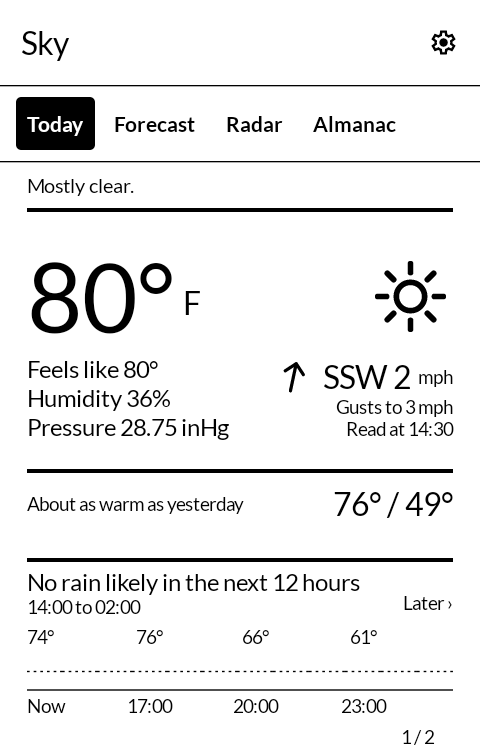
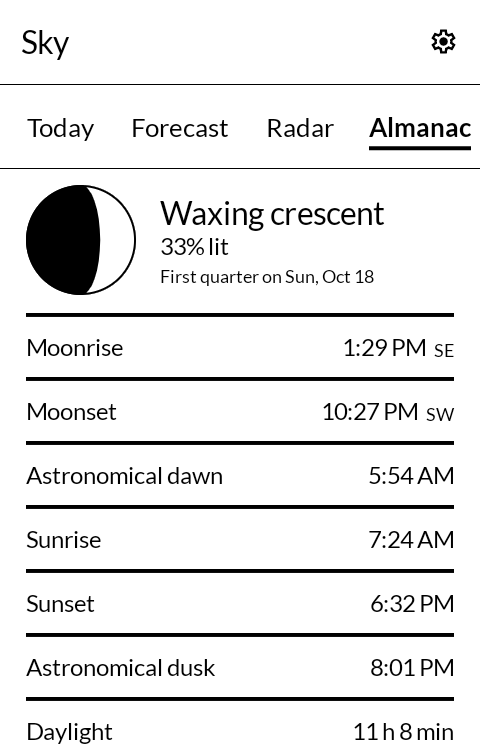
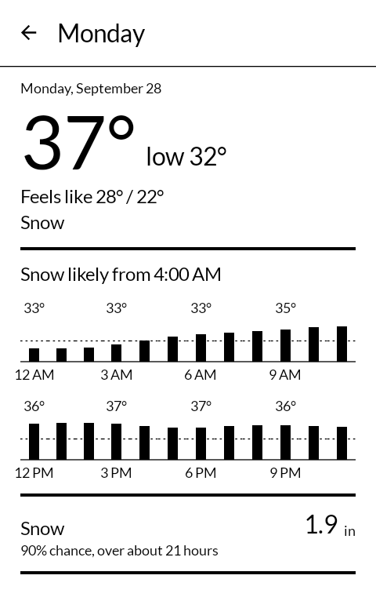
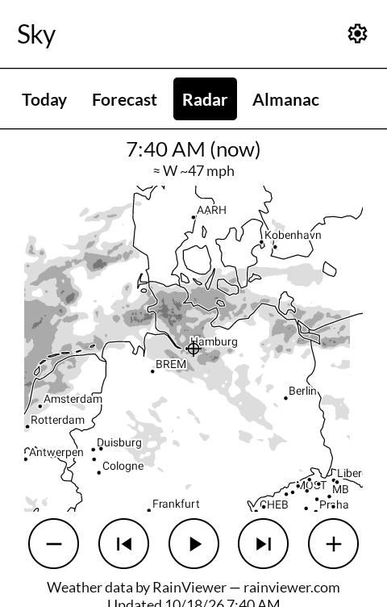

# 空模様 soramoyō — Sky

The days ahead, the rain radar, and your own weather station if you have one, on an
E Ink phone. Built for the [Mudita Kompakt](https://mudita.com/products/kompakt/), and it
will install on any device with Android 11 or later, Supernote's tablets among them.

*Soramoyō* is 空模様 — the look of the sky, which is how Japanese asks what the weather is
doing. It covers the station and the radar alike, and says no more than either of them
knows.

A fork of [kRadar](https://github.com/ok1cdj/kRadar) by Ondřej Koloničný. The radar is his;
the station and the forecast are added here.

| | |
|---|---|
|  |  |
|  |  |

## What it shows

Four tabs: **Today**, **Forecast**, **Radar** and **Almanac**. Today opens.

**The station, if you have one.** Temperature, what it feels like, wind and gusts, rain today
and whether it is falling now, humidity, dew point, pressure and UV, from one of four kinds:

- **An Ecowitt gateway** (and the stations sold under other names that use one), read on your
  own network through the same local page its app uses. No account and no key. Tried on a
  GW3000 with a WS90, and shown in the units the gateway is set to. Soil moisture too, if you
  have a probe.
- **Weather Underground**, for any station that uploads there, which is most makes. Read back
  through Weather Underground's servers, a minute or two behind, with the free API key it
  gives station owners (wunderground.com, your devices, then API keys). ⚠ Those keys expire
  and need renewing on the same page. Tried against a live station.
- **A WeatherFlow Tempest**, heard on your own network: its hub broadcasts a reading about once
  a minute. A Tempest sends no total for the day's rain and no feels-like, so those two are
  not shown for one. **Written from WeatherFlow's published format and not yet tried on a
  real Tempest.**
- **A Davis WeatherLink Live**, read on your own network through its local API. **Written from
  Davis's published format and not yet tried on a real one.**

If you have a Tempest or a Davis and it works, or does not, an issue here is the way to say so.

Without a station, Today leads with the forecast's estimate of now instead — temperature,
feels-like, wind and humidity, marked as an estimate and for what time.

**The forecast.** Today's high and low and chance of rain sit under the station reading,
with sunrise and sunset and how the high compares with yesterday's; the Forecast tab has the five days after it, each with how much rain
(or snow) is expected, and what the day will feel like where wind or damp make it colder or
hotter than it reads. Tap a day for its own page: its hours before and after noon, when rain
is likely and until when, the wind at its strongest, gusts, UV, sunrise and sunset, the hours
of sunshine, and the moon that day with its rise and set. Under today, the next twelve hours: one line saying when rain (or snow) is likely
to start or stop, and how much, over a strip of the hours with their temperatures and the
chance of rain drawn as bars. If the station says it is raining and the forecast does not,
the line says so. From [Open-Meteo](https://open-meteo.com/), for wherever the phone is or
for a place you choose.

**The day in words.** At the top of Today, a sentence or two worked out on the phone from the forecast already fetched: the sky, any rain or snow and when, the high and low, and the wind when it is worth a mention.

**The next two hours.** Under it, one line from Open-Meteo's quarter-hour rain forecast: "Rain in about 40 minutes", "Dry for the next two hours", or "Raining now, easing in about 30 minutes". Where the model has nothing for a place, the line is left out rather than saying dry.

**Pull down to refresh.** On Today, Forecast and a day's page, a swipe down from the top asks the station and the forecast again; a line at the top says "Updating…" and then "Up to date".

**The air.** Air quality, on the US index with imperial units and the European one with
metric, and in Europe the two heaviest pollens when there are any. From the Copernicus
Atmosphere Monitoring Service, by Open-Meteo: modelled, not measured.

**Units.** As the station reads, or else the phone's country, until metric or imperial is
chosen in settings; then everything follows, the station's readings included.

**The almanac.** The moon drawn as it looks tonight, its phase and how much of it is lit, and
when the next new, quarter or full moon falls; moonrise and moonset, each with the compass
point it is at; astronomical dawn, sunrise, sunset, astronomical dusk and the daylight
between; and a month of moons, a week to a row, with the other months a press away. All of it
is worked out on the phone from where it is, so it is there with no signal. Far enough north
it says so when the sun does not set, or the night does not get fully dark.

**The radar.** kRadar's radar, unchanged at heart: the last two hours of
[RainViewer](https://www.rainviewer.com/) radar over a vector map centred on the phone, a
locally estimated half hour ahead, marked `≈`, and zoom. State and province lines are drawn
where Natural Earth has them — the US, Canada, Australia and the other large federations —
which kRadar's map leaves out.

**Alerts.** In the United States, the warnings, watches and advisories the National Weather
Service has issued for the place: Red Flag Warnings and Fire Weather Watches, evacuation and
fire warnings where they are issued, and the rest — tornado, flood, winter storm, heat. While
one is in effect a line at the top of Today names it and says until when; a press opens them
all, each with its headline, the areas it covers, its times and what it says to do. Outside the
US there are none: the Weather Service covers only the United States.

A notification can come too, once, when a new alert that is severe or extreme, or one for fire
weather or an evacuation, is issued for the first place (the one chosen, else wherever the app
last found the phone). Settings → Notifications for serious weather alerts; on at first only if
the phone already lets Sky notify. While it is on, the Weather Service is asked every half hour
when the phone has a network, at a time Android picks to suit the battery. It is the one thing in
Sky that runs on a timer, and it stops when the setting is off.

**Where it is for.** A Kompakt has no network location, only its GPS, and indoors on a
phone that has never had a fix the GPS may not find itself at all. So in settings the
forecast and the radar can be given a place by name instead — "Portland, Maine",
with the state after a comma to pick one town out of several. While a place is set, the
phone's position is not read.

**A second place.** Someone who lives in one town and works in another can set a second
place the same way. The two names then sit at the top of the screen, and a press goes over to
the other: Today, Forecast, Radar and Almanac all follow. The station belongs to the first place and is
left out while the second is shown; the lock screen stays with the first too. With no second
place set, nothing changes.

Away from home a station on your own network cannot be reached, and the screen says so,
keeping the last reading and the time it was taken.

## What it does not do

No history, no charts and no widget. It shows what the station reads when you
open it. For a record, most stations can already upload to Weather Underground, Ecowitt and
others.

## What leaves the phone

An Ecowitt, Tempest or Davis station is read on your own network, and nothing it says leaves
the phone. A Weather Underground station is read from Weather Underground, with your key.

The radar, the forecast and the air all need to know roughly where the phone is, or the
places you chose. Each is rounded to two decimal places — about a kilometre — before it
leaves the phone, and it goes to Open-Meteo for the forecast and the air, and to RainViewer
for the radar tiles, and to the US National Weather Service (api.weather.gov) for alerts — with
the app's name and the address of this repository, which the Weather Service asks callers to
give, and nothing else. A place you search for is sent, as typed, to Open-Meteo's place search.
The almanac sends nothing; it is worked out on the phone.

With [Glance](https://github.com/wanderwildwood/hitome) installed, the weather also shows on
the lock screen: the temperature, the day's high and low, and when rain is likely. Looking at
the lock screen fetches the forecast the same way opening the app does, at most once every half
hour, and nothing runs on a timer. Settings → The weather on the lock screen turns it off; the
lines go to Glance alone.

With [Clock](https://github.com/wanderwildwood/tokei) installed and its setting for it switched
on, an alarm ringing shows the same first line: the temperature, the sky and the day's high and
low. That line goes to Clock alone, and only when Clock asks.

With no place set, if the phone's cached position is more than fifteen minutes old, a fresh
one is asked for before either is fetched, rather than showing the weather for wherever the
phone last was.

## Building

```
./gradlew assembleRelease
```

A release is signed by a keystore in `signing/`, which is not in this repository. Without
it the release APK builds **unsigned** and will not install anywhere — there is no
fallback key by design.

The base map is Natural Earth, baked into `app/src/main/assets/` by
`tools/convert_mapdata.py`, which is kRadar's with state lines added. Regenerate only the
state lines with `python3 tools/convert_mapdata.py --only states`: the committed
`cities.json` carries kRadar's hand-made Czech overlay, which a full run without the
MeteoPlaneRadar sources beside this repo would drop.

## Credit

The radar — the RainViewer client, the e-ink conversion of its tiles, the cloud-motion
forecast, the Web Mercator map and its drawing — is
[kRadar](https://github.com/ok1cdj/kRadar) 1.4 by Ondřej Koloničný (OK1CDJ), GPL v3, and
its history is kept in this repository's. What changed on that side: the screen now sits
in the house top bar with a way back, uses the house type and icons, clips its map to the
square, draws state lines, rounds the position, asks for a fresh fix when the cached one is stale, writes times
the phone's way, and no longer has the hidden test mode.

Radar data by [RainViewer](https://www.rainviewer.com/api.html). Forecast by
[Open-Meteo](https://open-meteo.com/), CC BY 4.0. Borders and cities from
[Natural Earth](https://www.naturalearthdata.com/), public domain. Icons are
[Material Symbols](https://fonts.google.com/icons), Apache License 2.0. The interface is
[MMD](https://github.com/mudita/MMD), Mudita's E Ink component library.

## Privacy

Privacy: what the app stores and what it sends is set out in [PRIVACY.md](PRIVACY.md).

## Licence

GNU General Public License v3, as kRadar is. See [LICENSE](LICENSE).

The radar is Copyright © Ondřej Koloničný. The station, the forecast and the changes are
Copyright © wander wildwood.
